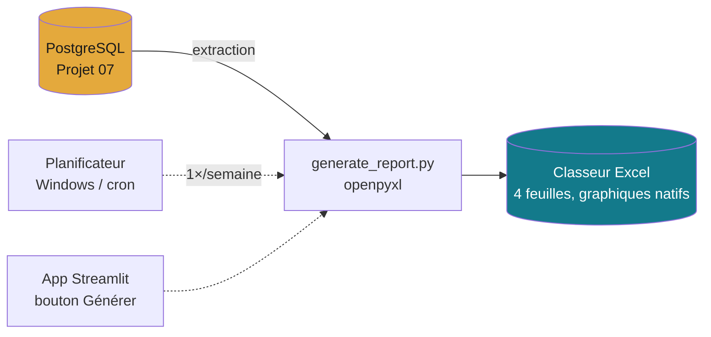

# Projet 06 — Automatisation d'un reporting Excel

[](https://github.com/valentinratigniet-byte/projet-06-automatisation-reporting-excel/actions/workflows/ci.yml)

> Beaucoup d'équipes refont **chaque semaine le même rapport Excel à la main**. Ce
> projet supprime la corvée : un script régénère le rapport tout seul — mis en forme,
> avec KPIs et graphiques — planifiable, avec une mini-interface. **Impact concret :
> ~38 heures/an rendues aux équipes.**

## 📊 Ce qui est produit



Un classeur Excel **mis en forme par le code** (`output/exemple_rapport_ventes.xlsx`),
4 feuilles :

| Feuille | Contenu |
|---|---|
| **Synthèse** | KPIs (CA, commandes, panier moyen, croissance) en en-tête |
| **CA mensuel** | tableau + **graphique en courbes** natif Excel |
| **Top produits** | top 10 + **barres de données** (mise en forme conditionnelle) |
| **Par catégorie** | tableau + **histogramme** |

Couleurs, formats €, bordures, graphiques : tout est généré programmatiquement
(openpyxl), identité « Petrol & Ambre ».

## ⏱️ Gain de temps (voir [docs/gain-de-temps.md](docs/gain-de-temps.md))

| | À la main | Automatisé |
|---|---|---|
| Par rapport | ~48 min | **< 1 min** |
| Par an | ~38 h | **~0 h** |
| Erreurs | possibles | **nulles** (déterministe) |

## 🚀 Utiliser

Prérequis : base du [Projet 07](https://github.com/valentinratigniet-byte/projet-07-base-ecommerce) lancée (Docker, port 5433).

```bash
pip install -r requirements.txt

# Générer le rapport (ligne de commande)
python src/generate_report.py            # → output/rapport_ventes_<date>.xlsx

# Ou via la mini-app (MVP)
streamlit run src/app.py                 # bouton "Générer" + téléchargement
```

## 🕗 Planifier (sans intervention manuelle)

- **Windows** — Planificateur de tâches → action `python src\generate_report.py`.
- **Linux/macOS** — cron : `0 8 * * 1 cd /chemin && python src/generate_report.py`.

Détails dans [docs/gain-de-temps.md](docs/gain-de-temps.md).

## 🗂️ Structure

```
projet-06-automatisation-reporting-excel/
├── src/
│   ├── generate_report.py   ← extraction Postgres → Excel mis en forme (openpyxl)
│   └── app.py               ← mini-app Streamlit (MVP)
├── output/
│   └── exemple_rapport_ventes.xlsx  ← exemple généré (versionné)
├── requirements.txt
└── docs/gain-de-temps.md    ← note avant/après (impact business)
```

---

*Projet 06 du [Portfolio Data](https://github.com/valentinratigniet-byte). Automatiser une corvée récurrente et **chiffrer
le temps gagné** — l'impact business le plus tangible.*
